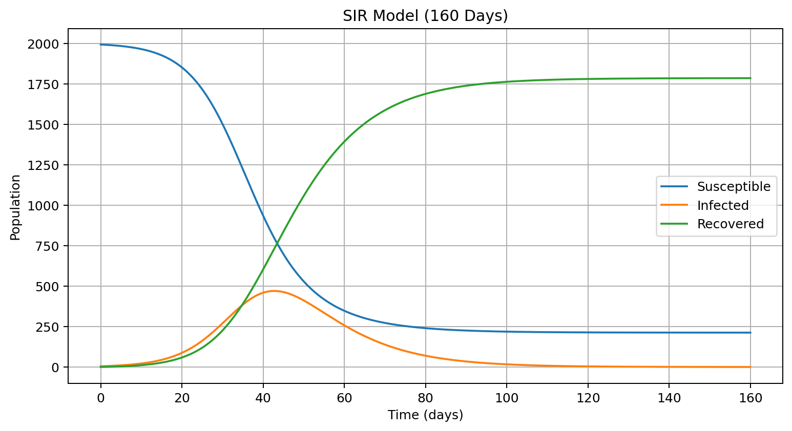
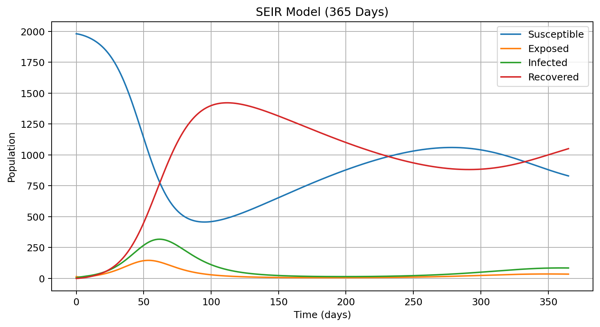
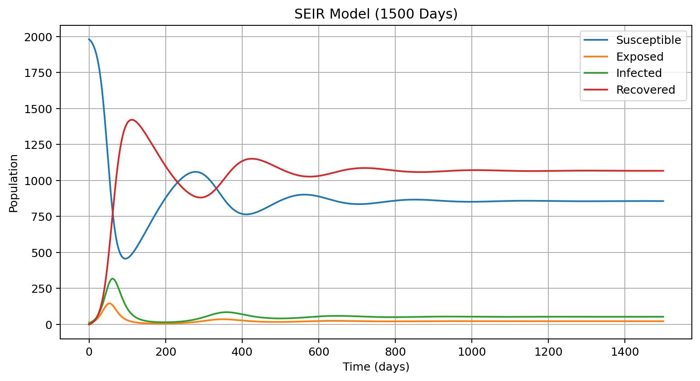
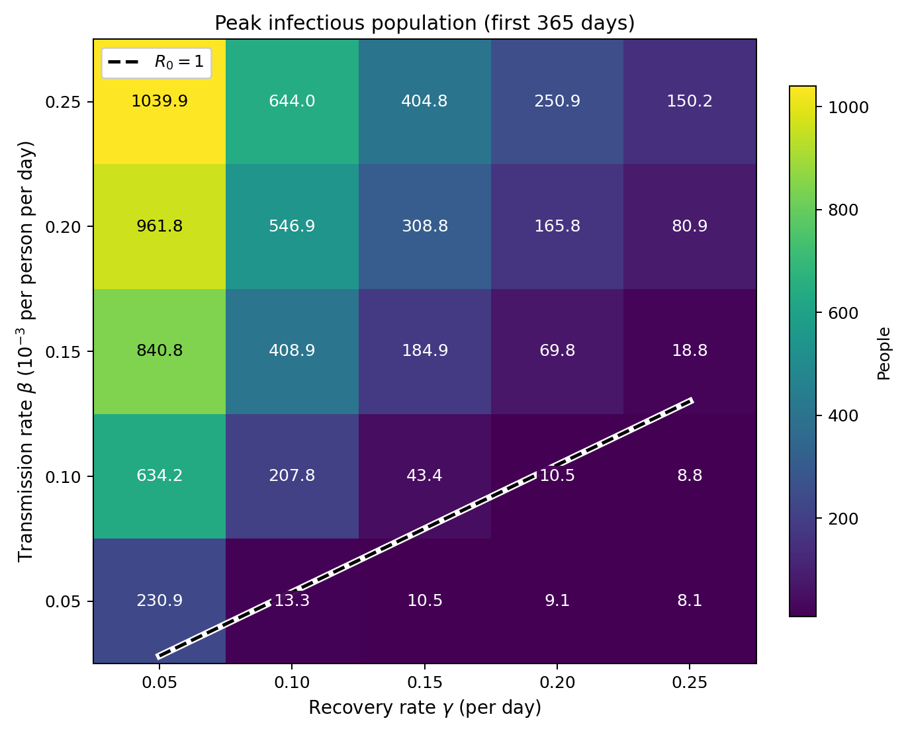
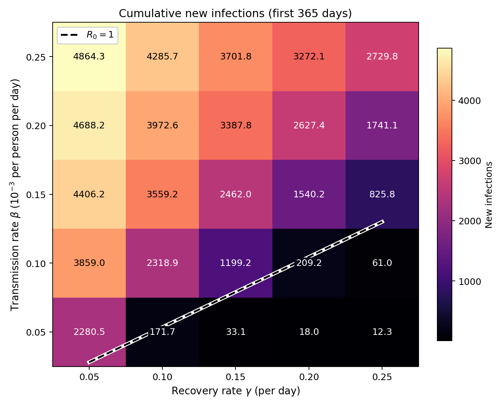

# BMI 500 Homework 1: SIR and SEIR Models

**Name:** Zezheng Sun  
**Email:** zsun264@emory.edu  
**Question:** HW 1 — SIR and SEIR Model Implementation for Pandemic Spread

## 1. Introduction

In this homework, I implemented SIR and SEIR models using Python to study how infectious diseases spread over time.

I used the forward Euler method with a time step of 0.1 day. I first simulated the SIR model, then extended it to the SEIR model with an exposed group, births, and deaths.

I also tested different transmission and recovery rates to understand how these parameters affect infection peaks and cumulative infections.

## 2. Files

- `HW1_SIR_SEIR.ipynb`: Python code, calculations, and plots for Parts A–E.
- `hypothesis.pdf`: My original handwritten hypothesis.
- `README.md`: Results and discussion.
- `figures/`: Figures exported from the notebook.
- `slide.pdf`: Required one-slide presentation, to be created independently and added before submission.

## 3. How to Run

The project uses Python 3 with NumPy, Matplotlib, Jupyter, and ipykernel.

```bash
python3 -m venv .venv
source .venv/bin/activate
python -m pip install numpy matplotlib jupyter ipykernel
python -m jupyter notebook HW1_SIR_SEIR.ipynb
```

Open a terminal in this project folder before running the commands above. Run all notebook cells from top to bottom.

In VS Code, select the `.venv` Python environment as the notebook kernel and click **Run All**.

## 4. Parts A–B: SIR Model

The SIR model divides the population into three groups:

- **Susceptible (S):** People who can become infected.
- **Infected (I):** People who are currently infectious.
- **Recovered (R):** People who have recovered and are assumed to be immune.

The equations are:

$$
\frac{dS}{dt}=-\beta SI
$$

$$
\frac{dI}{dt}=\beta SI-\gamma I
$$

$$
\frac{dR}{dt}=\gamma I
$$

The model uses population counts, so the infection term is `beta * S * I`, without dividing by the total population.

### Parameters

| Parameter | Value |
|---|---:|
| Total population | 2000 |
| Initial susceptible | 1995 |
| Initial infected | 5 |
| Initial recovered | 0 |
| Transmission rate (β) | 0.000125 per person per day |
| Recovery rate (γ) | 0.1 per day |
| Simulation time | 160 days |
| Time step | 0.1 day |

At each step, Euler's method calculates all rates from the previous populations, then updates each population using `new value = old value + rate * dt`.

The simulation shows that susceptible people decrease, infected people first increase and then decrease, and recovered people continue to increase.



*Figure 1. SIR populations over 160 days. Infections peak near day 43, then decline as fewer susceptible people remain.*

## 5. Part C: SIR Results and Interpretation

The main SIR results are:

| Result | Value |
|---|---:|
| Peak infected population | 470.46 |
| Day of infection peak | 42.7 |
| Basic reproduction number (R₀) | 2.50 |
| Susceptible at day 160 | 212.79 |
| Infected at day 160 | 0.20 |
| Recovered at day 160 | 1787.01 |

### Infection Peak

The infected population reaches its peak at about day 42.7, with 470.46 infected people.

At the beginning, there are many susceptible people, so infections increase quickly. As more people become infected and recover, the susceptible population decreases.

The infection growth rate is:

$$
\frac{dI}{dt}=I(\beta S-\gamma)
$$

The infected population starts to decrease when:

$$
S < \frac{\gamma}{\beta}=800
$$

The peak occurs near S = 800, when new infections and recoveries balance. Higher transmission, slower recovery, and more susceptible people allow infections to grow faster.

### Basic Reproduction Number

For the SIR model:

$$
R_0=\frac{\beta N}{\gamma}=2.5
$$

R₀ = 2.5 means that one infectious person would infect about 2.5 people on average in a fully susceptible population. Because this is greater than 1, infections can initially grow.

As S decreases, the effective reproduction number, `beta * S / gamma`, also decreases. Infections decline once this falls below 1. Reducing transmission or shortening the infectious period helps bring this number below 1.

### Final Population

At day 160, about 213 people remain susceptible and have never been infected. The infectious population is about 0.20, so the outbreak is nearly over but has not reached exactly zero. Fractional people are expected because this is a continuous population model.

This means the epidemic can become very small even though some people were never infected. There are not enough susceptible people left to maintain strong transmission under these model settings.

The total population stays close to 2000 during the simulation, with only very small numerical rounding errors.

## 6. Part D: SEIR Model with Births and Deaths

I extended the SIR model by adding an exposed (E) group.

The SEIR model includes:

- **Susceptible (S):** People who can become infected.
- **Exposed (E):** People who are infected but not yet infectious.
- **Infected (I):** People who can transmit the disease.
- **Recovered (R):** People who have recovered.

The model also includes births and natural deaths.

### SEIR Equations

$$
\frac{dS}{dt}=\mu N-\beta SI-\mu S
$$

$$
\frac{dE}{dt}=\beta SI-(\sigma+\mu)E
$$

$$
\frac{dI}{dt}=\sigma E-(\gamma+\mu)I
$$

$$
\frac{dR}{dt}=\gamma I-\mu R
$$

### Parameters

| Parameter | Value |
|---|---:|
| Total population | 2000 |
| Initial S | 1980 |
| Initial E | 15 |
| Initial I | 5 |
| Initial R | 0 |
| β | 0.000125 per person per day |
| γ | 0.1 per day |
| σ | 0.25 per day |
| μ | 0.005 per day |
| Time step | 0.1 day |
| Simulation periods | 365 and 1500 days |

### SEIR Simulation Results

I simulated the SEIR model for both 365 days and 1500 days.

The 365-day simulation shows the first two infection peaks. The 1500-day simulation shows more repeated infection waves.



*Figure 2. The first year includes a large initial wave and a smaller second peak near day 359.*



*Figure 3. Repeated waves become smaller as the populations approach an endemic equilibrium.*

The infection peaks are:

| Wave | Peak day | Infected population |
|---|---:|---:|
| 1 | 61.7 | 317.60 |
| 2 | 359.4 | 85.09 |
| 3 | 648.0 | 59.66 |
| 4 | 937.8 | 54.76 |
| 5 | 1227.9 | 53.68 |

The first infection wave is the largest. Later waves become smaller and gradually approach a stable level.

The exposed group creates a delay before people become infectious. Also, births continuously add new susceptible people to the population, which allows transmission to continue.

### SEIR Reproduction Number

The basic reproduction number for this SEIR model is:

$$
R_0=\frac{\beta N\sigma}{(\sigma+\mu)(\gamma+\mu)}
$$

The calculated value is approximately:

**SEIR R₀ = 2.3343**

This is slightly lower than the SIR R₀ of 2.5. Some exposed people die before becoming infectious, and natural deaths also shorten the average time spent infectious. The exposed-stage delay alone would not reduce R₀ in this model if natural deaths were absent.

### Endemic Equilibrium

At day 1500, the simulated populations are close to the theoretical equilibrium.

| Population | Day 1500 | Theoretical equilibrium |
|---|---:|---:|
| S | 856.92 | 856.80 |
| E | 22.45 | 22.42 |
| I | 53.44 | 53.37 |
| R | 1067.20 | 1067.41 |

At equilibrium, the susceptible population is approximately:

$$
S^*=\frac{N}{R_0}=856.80
$$

Here, `N / R₀` is the susceptible population at which the effective reproduction number equals 1. At endemic equilibrium, flows into and out of each group balance, and the infectious population approaches about 53.37 instead of zero.

This means that decreasing infection waves do not always mean the disease will disappear. In this model, infections can remain at a stable, nonzero level.

### Model Assumptions

The birth and death rate is μ = 0.005 per day, which gives an average lifespan of about 200 days.

This is much shorter than a realistic human lifespan. It also means susceptible people are replenished faster than in a realistic human population.

With a realistic human lifespan, births would replenish susceptible people much more slowly. Later waves would generally occur on a longer timescale and might not be visible within 1500 days. These simulations illustrate the model dynamics rather than directly predicting a real epidemic.

## 7. Part E: Parameter Sensitivity Analysis

In this part, I tested how the transmission rate (β) and recovery rate (γ) affect the SEIR model.

I used five values for each parameter:

**β values (per person per day):** 0.00005, 0.00010, 0.00015, 0.00020, 0.00025

**γ values (per day):** 0.05, 0.10, 0.15, 0.20, 0.25

This gives 25 parameter combinations.

For each combination, I simulated 365 days and calculated:

1. Peak infected population.
2. Cumulative new infections.

Cumulative new infections were calculated using:

$$
\text{Cumulative infections}
=\sum \beta SI\Delta t
$$

This counts new infections during the simulation. It does not count the people who were already exposed or infected at day 0.

Because the model includes births, cumulative infections can be greater than the initial population of 2000.

### Heatmaps

The first heatmap shows the peak infected population for different β and γ values.



*Figure 4. Peak infectious population during the first 365 days. Each cell shows one parameter combination; the dashed line marks R₀ = 1.*

The second heatmap shows cumulative new infections during 365 days.



*Figure 5. Cumulative new infections during the first 365 days, with the same R₀ = 1 boundary.*

Above the R₀ = 1 line, the model permits sustained transmission; below it, transmission cannot sustain itself in the long term. Some infections can still occur below the line because the simulation starts with exposed and infectious people.

Across the tested grid, increasing β raises both outcomes, while increasing γ lowers them. Peak infections range from 8.08 to 1039.88, and cumulative new infections range from 12.30 to 4864.29.

Reducing β can represent public health interventions that reduce transmission, such as social distancing. Increasing γ can represent treatments that shorten the infectious period.

Both changes can reduce peak healthcare demand and the total number of new infections. In this model, a treatment affects γ only if it shortens the infectious period.

### Comparing β and γ

My original hypothesis was that β would have a larger effect on peak infections than γ.

However, the simulation shows that both parameters can strongly affect the infection peak.

As an additional check, I compared two 10% changes near the Part D baseline (β = 0.000125 and γ = 0.1), using the same 365-day model:

| Parameter setting | Peak infected |
|---|---:|
| Original β and γ | 317.60 |
| Reduce β by 10% | 265.05 |
| Increase γ by 10% | 263.38 |

In this comparison, increasing γ by 10% reduced the infection peak slightly more than reducing β by 10%.

Therefore, my hypothesis was not consistently supported. The relative effect depends on the parameter values and the changes being compared.

## 8. Discussion: Hypothesis Revisited

Before starting the simulations, I wrote three hypotheses.

### Hypothesis 1: SIR Infection Peak

I predicted that the SIR model would reach a peak of 400–600 infected people around days 70–100.

**Verdict: Partly supported.**

The peak infected population was about 470.46, which was within my predicted range. However, the peak happened on day 42.7, earlier than I expected.

### Hypothesis 2: Multiple SEIR Infection Waves

I predicted that the SEIR model would show multiple infection waves, especially during a longer simulation.

**Verdict: Supported.**

The 1500-day simulation showed five infection peaks. The peaks became smaller over time, and the model gradually approached an endemic equilibrium.

### Hypothesis 3: Effect of β and γ

I predicted that β would have a larger effect on the infection peak than γ.

**Verdict: Not consistently supported.**

Both β and γ had important effects. In one comparison near the baseline, increasing γ by 10% reduced the peak slightly more than reducing β by 10%.

This suggests that the effect of each parameter depends on the model settings.

### What I Learned

This homework helped me understand how SIR and SEIR models describe disease transmission.

I learned that a short simulation may not show the full long-term behavior of a disease. The SEIR model can have repeated infection waves and approach a nonzero equilibrium.

I also learned that model parameters and assumptions are important. Even when the numerical calculations are correct, unrealistic parameter values can make the results different from real-world disease patterns.

### Limitations

These models use several simplified assumptions:

- Transmission and recovery rates are constant.
- People are assumed to mix equally.
- Recovered people do not become susceptible again.
- The birth and death rates are simplified.
- The model does not include vaccination or changes in human behavior.

These models help explain possible disease patterns, but they are not exact predictions. A useful extension would allow transmission to change over time or include vaccination.

As numerical checks, I verified population conservation and nonnegative populations. Halving the Euler time step from 0.1 to 0.05 day changed the Part E peaks by at most 1.82 people and cumulative infections by at most 1.28. The results are numerically stable at this scale, although Euler remains an approximation.

## 9. AI Usage Statement

**Complete AI conversation records:**

Statement: ChatGPT (Codex) was used to complete this homework. The full chat is available at: [ADD PUBLIC CHAT URL(S)].
